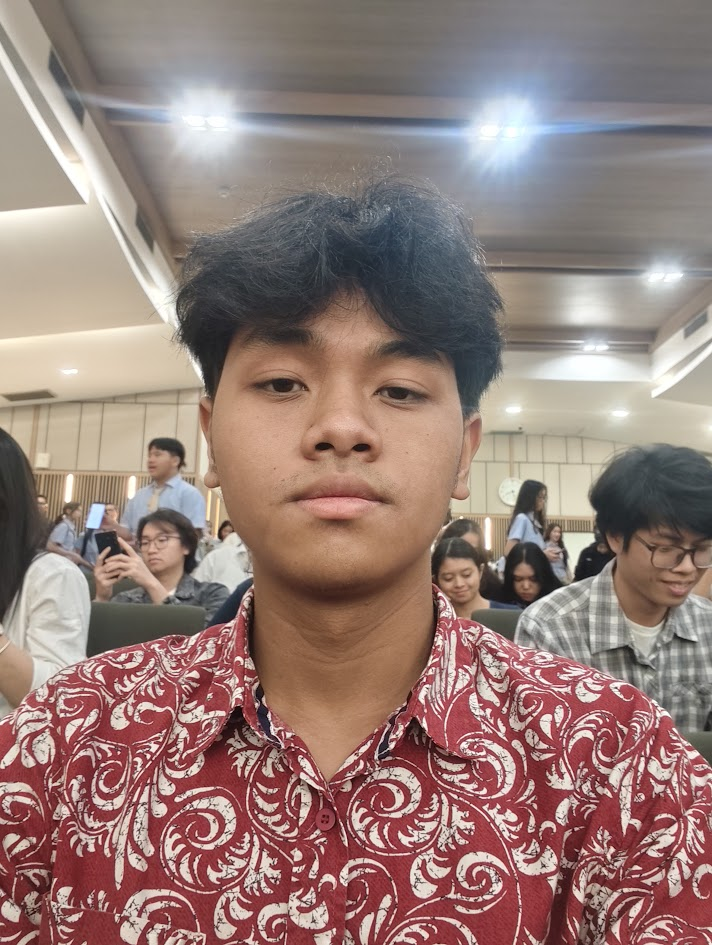
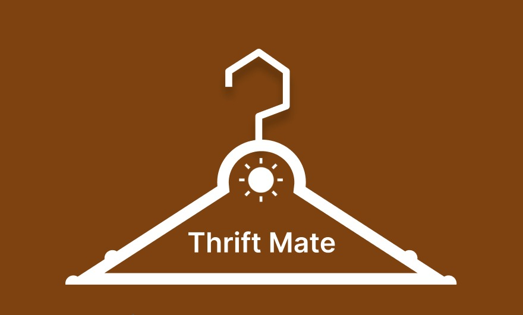
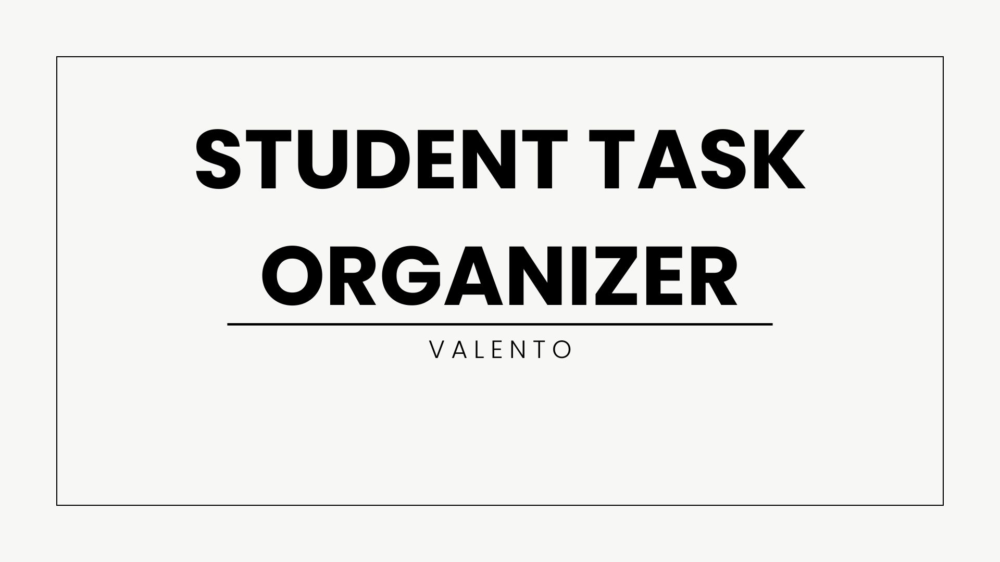
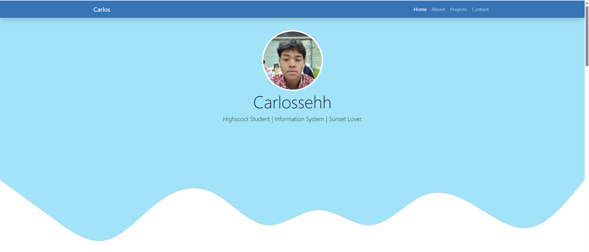

# glowing-fiesta — Carlos Portfolio

Website portfolio pribadi bertema **dark mode** yang dibangun dengan HTML, CSS, dan JavaScript murni (tanpa framework). Berisi profil, linimasa pendidikan, galeri proyek dengan modal detail, orbit animasi daftar skill, dan bagian kontak. Dipublikasikan otomatis ke **GitHub Pages** lewat GitHub Actions.

**Live site:** https://veryrareuser.github.io/glowing-fiesta/

## Fitur

- **Background partikel** — canvas HTML5 dengan 80 partikel bergerak dan `requestAnimationFrame`.
- **Efek mengetik** pada hero, dengan kursor berkedip.
- **Scroll-spy navbar** — indikator biru yang bergeser mengikuti section yang sedang dibaca.
- **Modal proyek** — klik kartu proyek untuk membuka deskripsi detail; dapat ditutup lewat tombol `×`.
- **Linimasa pendidikan** dengan animasi garis yang tumbuh otomatis.
- **Orbit skill** — label skill (HTML, CSS, JS, SQL, C#, Figma) berputar mengelilingi lingkaran pusat.
- **Desain responsif** — grid proyek berubah dari 3 kolom menjadi 1 kolom di bawah 768px.
- Efek *glassmorphism* (blur + transparansi) pada header dan kartu proyek.

## Bagian Halaman

| Section | Isi |
| --- | --- |
| **Hero** | Efek ketik "Hello, I'm Carlos", status akademik, tombol CTA |
| **About** | Foto profil + deskripsi singkat |
| **Education** | Linimasa SD → SMP → SMA → Universitas |
| **Projects** | 3 kartu proyek dengan modal deskripsi |
| **Skills** | Orbit skill yang berputar |
| **Contact** | Instagram, GitHub, dan nomor telepon |

## Proyek yang Ditampilkan

| Proyek | Deskripsi |
| --- | --- |
| **Thrift Mate** | Aplikasi untuk membeli dan menjual barang bekas, mendorong keberlanjutan dan harga terjangkau |
| **Student Task Organizer** | Organizer tugas mahasiswa berbasis terminal: daftar tugas beserta pengingat tenggat |
| **Internship Web** | Website proyek magang |

## Tech Stack

| Lapisan | Teknologi |
| --- | --- |
| Markup | HTML5 |
| Styling | CSS3 (custom properties, keyframe animation, `backdrop-filter`) |
| Interactivity | Vanilla JavaScript (ES6) |
| Font | Poppins (Google Fonts) |
| Deployment | GitHub Pages via GitHub Actions |

## Struktur Proyek

```
.
├── .github/
│   └── workflows/
│       └── static.yml     # Workflow deploy otomatis ke GitHub Pages
├── assets/
│   ├── p1.jpg             # Thumbnail Thrift Mate
│   ├── p2.jpg             # Thumbnail Student Task Organizer
│   ├── p3.png             # Thumbnail Internship Web
│   └── profile.jpg        # Foto profil pada section About
├── index.html
├── script.js              # Partikel canvas, typing effect, modal, scroll-spy
├── style.css
└── README.md
```

## Preview

Foto profil pada section About:



Kartu proyek:

| Thrift Mate | Student Task Organizer | Internship Web |
| --- | --- | --- |
|  |  |  |

## Menjalankan Secara Lokal

Tidak ada build step dan tidak ada dependensi yang perlu diinstal:

```bash
# Opsi 1: buka langsung
start index.html

# Opsi 2: jalankan server statis ringan
npx serve .
```

Lalu buka `http://localhost:3000`.

## Deployment

Workflow `.github/workflows/static.yml` berjalan otomatis pada setiap push ke branch `main`:

1. Checkout repository.
2. Upload seluruh isi repository sebagai artifact Pages.
3. Deploy ke GitHub Pages dengan environment `github-pages`.

Status build dapat dilihat pada tab **Actions** di repository ini.

## Catatan

- Seluruh kode front-end ditulis manual; tidak ada bundler, package manager, atau proses build.
- Ikon skill dan aset gambar disimpan lokal di `assets/`.
- Efek partikel berjalan di canvas full-screen di belakang konten.
